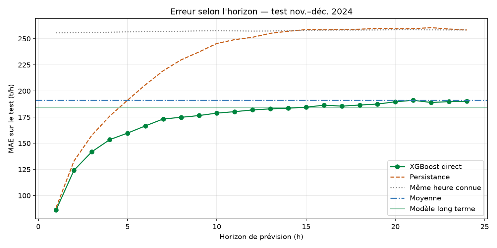

# Prévision du débit horaire — Pipeline OCP Khouribga → Jorf Lasfar

Projet de fin d'études — stage OCP Jorf Lasfar 2025.
Auteur : Nada Elaali — Superviseur : M. Othmane Salama

## Objectif
Prévoir le débit horaire total (t/h) à distribuer aux clients de Jorf Lasfar
(IMACID, JFO, JFD, JFT, JFQ, JFF, PMP), de 1 heure à 2 ans à l'avance (jusqu'à fin 2026), avec une
fourchette d'incertitude.

## Architecture

```
Data/                       fichiers Excel bruts (non versionnés)
ocp_ml/                     pipeline partagé entraînement / API
  config.py                 chemins, graine, dates de découpage, seuils
  data.py                   nettoyage -> série horaire régulière
  features.py               variables explicatives (sans fuite du futur)
  modeling.py               entraînement, évaluation, intervalles
  prevision.py              service de prévision utilisé par l'API
train.py                    entraînement complet -> models/ + reports/
backend/main.py             API FastAPI
frontend/                   interface React (Vite)
tests/                      tests automatisés (pytest)
```

## Traitement des données
Source unique : `dataset_OCP_pipeline.xlsx` (relevés horaires par client) complété
par `Extraction JFT Mai et Juin.xlsx`.

1. **Doublons** : les fichiers mensuels se chevauchent (93 lignes identiques en double), supprimés.
   L'audit complet (avant / après) est recalculé à chaque entraînement (`reports/qualite.json`)
   et affiché dans la page « Qualité des données ».
2. **Pas horaire régulier** : réindexation heure par heure ; trous ≤ 3 h interpolés, trous plus longs laissés vides.
3. **Débit total** = somme des clients, **JFT inclus sur toute la période** (absent de mai–juin
   dans le fichier principal, complété par l'extraction JFT).
4. **Arrêts opérationnels** (< 500 t/h) : non prévisibles, exclus de la cible mais conservés dans l'historique.
5. **Pas de fuite** : les ventes réalisées du jour ne sont connues qu'en fin de journée ; seule la valeur de J-1 est utilisée.

## Modélisation
- **Court terme (1–24 h)** : stratégie *directe* — un modèle XGBoost par horizon, à partir
  des 168 dernières heures (débit total, état de chaque client, moyennes glissantes, nombre d'arrêts)
  et du calendrier de l'heure visée. Pas d'accumulation d'erreur comme en prévision récursive.
- **Long terme (> 24 h, jusqu'à fin 2026)** : profil calendaire (heure, jour de semaine, jours fériés).
  Entre 12 h et 24 h, la prévision glisse progressivement d'un modèle à l'autre.
- **Intervalle à 80 %** : quantiles des résidus hors échantillon, par horizon.

## Validation
Découpage chronologique fixe, sans recouvrement entre périodes :

| Période | Rôle |
|---|---|
| mai → sept. 2024 | entraînement |
| oct. 2024 | validation (nombre d'arbres, calibration des intervalles) |
| nov. → déc. 2024 | test (jamais vu pendant la mise au point) |

Chaque modèle est comparé à des références simples : persistance (« le débit restera
le même »), même heure du jour précédent, moyenne.

## Résultats (test nov.–déc. 2024)

| Horizon | MAE modèle | MAE persistance | MAE moyenne | R² | Couverture 80 % |
|---|---|---|---|---|---|
| 1 h | **86,3** | 88,6 | 191,2 | 0,746 | 0,80 |
| 3 h | **141,9** | 157,7 | 190,5 | 0,408 | 0,82 |
| 6 h | **166,6** | 205,9 | 190,5 | 0,207 | 0,82 |
| 12 h | **181,9** | 251,3 | 190,9 | 0,084 | 0,80 |
| > 24 h (long terme) | **184,2** | — | 191,3 | — | 0,81 |



**Lecture** : le débit dépend des mises en marche / arrêts des clients (~300 t/h chacun),
qui ne sont prévisibles que quelques heures à l'avance. Le modèle apporte le plus de valeur
entre 2 et 12 h (jusqu'à −28 % d'erreur par rapport à la persistance). Au-delà de 24 h,
on prévoit le profil habituel avec une fourchette honnête.

> L'ancienne version annonçait R² = 0,96 / MAE = 14 t/h. Ces chiffres ne sont pas
> reproductibles : sur son propre test, l'ancien modèle (MAE 69,9) faisait moins bien que
> la persistance (68,4), utilisait les ventes du jour même (fuite) et une cible incohérente
> (JFT ajouté en mai seulement).

## Reproductibilité
- Graine unique (`SEED = 42`), découpage par dates fixes, versions figées (`requirements.txt`).
- Empreinte SHA-256 des fichiers de données enregistrée dans `models/metadata.json`.
- Deux entraînements successifs produisent des modèles identiques octet par octet (vérifié par test).
- Chaque entraînement est enregistré dans MLflow (`mlflow.db`).

## Utilisation

Lancement en une commande (API + interface + navigateur) :

```powershell
powershell -ExecutionPolicy Bypass -File .\lancer.ps1             # -Entrainer pour re-entrainer avant
```

Ou étape par étape :

```powershell
py -3.12 -m pip install -r requirements.txt
py -3.12 train.py                 # ~30 s : models/ + reports/
py -3.12 -m pytest                # tests

cd backend;  py -3.12 -m uvicorn main:app --reload --port 8000
cd frontend; npm run dev          # http://localhost:5173
```

Interface MLflow : `py -3.12 -m mlflow ui --backend-store-uri sqlite:///mlflow.db`

## Limites et pistes
- 8 mois de données (mai–déc. 2024) : pas de saisonnalité annuelle apprise (janvier–avril jamais observés).
- Les arrêts et les plannings de production ne sont pas dans les données ; les intégrer
  (planning d'expédition, maintenance prévue) est le levier principal d'amélioration.
- Une prévision du volume journalier (t/jour) serait nettement plus stable que l'horaire.
